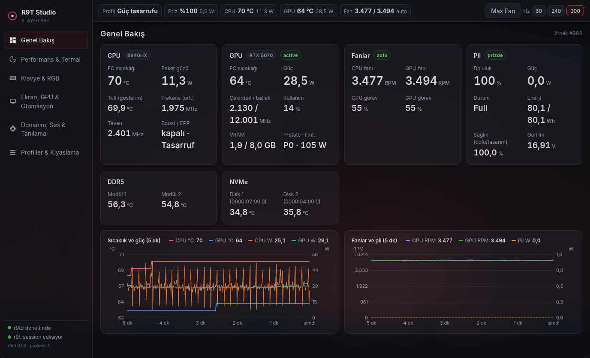
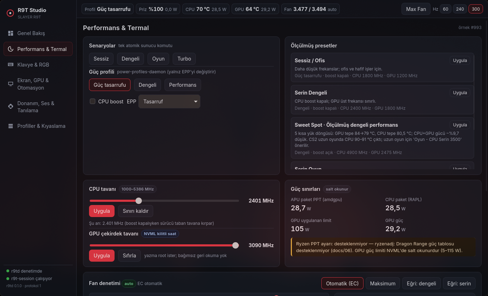
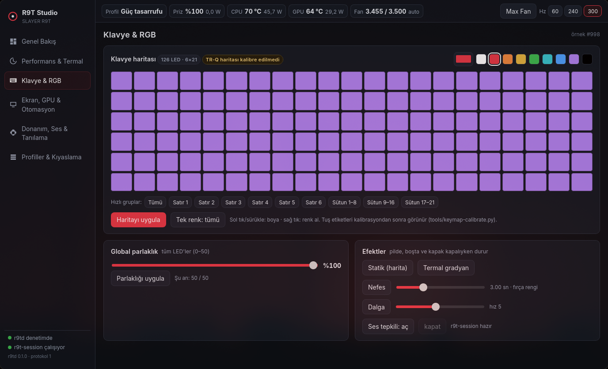

# Kontrol Merkezi Linux — R9T Studio

**GameGaraj Slayer R9T için saf Rust ile yazılmış Linux kontrol merkezi.** Güç profilleri, CPU/GPU sınırları, fanlar, RGB klavye, ekran, ses ve tanılama tek arayüzde. Donanım servisi `r9td`, masaüstü ajanı `r9t-session`, komut satırı `r9tctl` ve Tauri v2 + Svelte 5 arayüzü; Arch paketleriyle kurulur.



| Performans & Termal | Klavye & RGB |
|---|---|
|  |  |

Windows kontrol merkezinin bütün özelliklerini kapsadığı ya da başka oyun laptoplarında çalıştığı iddia edilmez. Kanıtlanmamış yetenek arayüzde etkin görünmez.

## Hangi bilgisayar için?

| Bileşen | Doğrulanan yapılandırma |
|---|---|
| Laptop | GameGaraj Slayer R9T (DMI `GAME GARAJ` / `SLAYER R9T`), BIOS `N.1.19GAR06` |
| İşlemci | AMD Ryzen 9 8940HX (16 çekirdek) |
| GPU | NVIDIA GeForce RTX 5070 Laptop (dahili eDP-1 dGPU'ya bağlı, 2560×1600 60/240/300 Hz) |
| Klavye | ITE8291, USB `048d:600b`, 126 kanal (6 × 21) RGB |
| Sistem | CachyOS, kernel 7.2.9 ve LTS 6.18.55, Hyprland 0.56 (KDE Plasma 6 da destekli) |

Başka modeller için EC adresleri doğrudan taşınmaz; servis DMI modelini ve EC kimliğini denetler.

## Neler yapıyor?

| Modül | İçerik |
|---|---|
| Genel Bakış | CPU/GPU EC sıcaklığı ve güç (RAPL paket wattı, NVML), fan RPM/görev, pil, DDR5 ve iki NVMe sıcaklığı; 5 dakikalık çift eksenli grafikler |
| Performans & Termal | Ölçülmüş presetler ve senaryolar, güç profili, CPU boost/EPP, CPU ve GPU frekans tavanları, sürüklenebilir fan eğrisi (%50 taban, canlı sıcaklık imleci), sıcaklık hedefi |
| Klavye & RGB | 6×21 ızgarada tıklayarak/sürükleyerek boyama, hızlı gruplar, global parlaklık; efektler: termal gradyan, nefes, dalga, ses tepkili (hoparlör çıkışını dinler) |
| Ekran, GPU & Otomasyon | Hz (60/240/300) ve parlaklık, açılış/priz/pil/oyun kuralları (Steam listesi), GPU Wake Inspector (dGPU'yu meşgul eden süreçler) |
| Donanım, Ses & Tanılama | Fn-Lock, kamera, USB-C PD, hoparlör/mikrofon, Wi-Fi/Bluetooth/uçak modu, s2idle analizi, süreç izleyici, denetim günlüğü |
| Profiller & Kıyaslama | Profil tablosu, JSON içe/dışa aktarma, 60 sn kararlılık testi ve A/B karşılaştırma |
| Tepsi | Renk = güç profili (kırmızı = termal koruma), ipucunda profil ve CPU/GPU °C, senaryo menüsü |
| Waybar | `r9tctl waybar --follow` modülü |

Ölçülen değerler: boşta arayüz CPU'su eDP-1 300 Hz'te %0,45 (odak dışında), r9td `status` p99 0,21 ms.

## Mimari

```text
r9t-studio/
├── crates/
│   ├── r9t-protocol/   JSON-RPC 2.0 (NDJSON) tipleri, alan başına yaş bilgili anlık görüntü
│   ├── r9t-hal/        donanım katmanı (cpufreq, RAPL, hwmon, tuxedo_io, r9t_fan, RGB, NVML), sahte sysfs ile test
│   ├── r9td/           root servis: tek okuyucu, tek yazıcı (termal otorite), polkit, uyku inhibitörü
│   ├── r9t-session/    kullanıcı ajanı: Hyprland/KDE, Hz, PipeWire, idle, oyun algılama, ses tepkili RGB
│   └── r9tctl/         CLI: status/probe/watch, waybar, geçiş (switch/desktop), tuş kalibrasyonu, yük testi
├── ui/                 Tauri v2 + Svelte 5 (soketlere yalnız Rust kabuğu bağlanır), ksni tepsisi
├── driver/
│   ├── r9t_fan/        fan köprüsü kernel modülü (C, DKMS): 15 sn lease, uyku ve hata halinde EC auto
│   └── tuxedo-drivers/ tuxedo-drivers 4.24.0 için R9T yaması (DMI eşleşmesi, 8 bit RGB yoğunluğu)
├── packaging/          systemd, polkit, sysusers, menü girişi, arch/ PKGBUILD'leri
└── docs/               plan (04), faz kanıtları (05–15)
```

Kod Rust'tır; C yalnız kernel modülü ve sürücü yamasıdır, kabuk yalnız PKGBUILD/DKMS derleme betiğidir.

**Güvenlik değişmezleri** (`r9t-studio/CLAUDE.md`): kernel lease 15 sn ve watchdog; duruşta fanlar EC otomatik; CPU ≥ 90 / GPU ≥ 84 °C'de fanlar %100; PWM tabanı %50; fan durma algılama; geçersiz sensör asla 0 °C sayılmaz; uykuda auto doğrulanır; tek yazıcı (`Conflicts=`, flock); doğrulanmamış EC adresine yazma yok.

## Kurulum (Arch / CachyOS)

```bash
cd r9t-studio/packaging/arch/tuxedo-drivers-r9t-dkms && makepkg
cd ../slayer-r9t-fan-dkms && makepkg
cd ../r9t-studio && makepkg -s
sudo pacman -U ../*/*.pkg.tar.zst
sudo usermod -aG r9t "$USER"          # yeniden giriş gerekir
sudo r9tctl switch --commit            # r9td kalıcı denetçi (deneme için: --trial 20)
r9tctl desktop --commit                # r9t-session, Hyprland satırı, menü girişi
```

Geri dönüş: `sudo r9tctl switch --rollback && r9tctl desktop --rollback`. Ayrıntılar: [packaging/arch/README.md](r9t-studio/packaging/arch/README.md).

## Geliştirme

```bash
cd r9t-studio
cargo test --workspace                  # r9t_fan C hata testi dahil (cc gerekir)
cargo clippy --workspace --all-targets
cd ui && npm ci && npx tauri build --no-bundle && (cd src-tauri && cargo test)
```

Plan ve kurallar: [r9t-studio/docs/04_ana_plan.md](r9t-studio/docs/04_ana_plan.md), [r9t-studio/CLAUDE.md](r9t-studio/CLAUDE.md). Donanım kabulü yalnız fiziksel ölçümle yapılır; CI (GitHub Actions) yalnız sahte sysfs ve bellek içi EC ile koşar.

## Durum

| Faz | Konu | Durum |
|---|---|---|
| 0–3 | Hazırlık, protokol/HAL, gölge modu, kontrol yolu ve oturum ajanı | Tamam |
| 4 | Arayüz (6 modül), tepsi, kalıcı geçiş | Tamam (KDE oturumunda kısa kontrol açık) |
| 5 | Arch paketleri, eski sistemin kaldırılması, r9t_fan v2 | Paketler kurulu ve günlük kullanımda; v2 ve bir haftalık kullanım sonrası temizlik açık |

Eski Python/Qt sistemi (Slayer R9T Kontrol Merkezi 0.12.0) depodan kaldırıldı; son hali [`legacy-0.12.0`](https://github.com/omerseyfettinozd/kontrol-merkezi-linux/tree/legacy-0.12.0) etiketinde.

## Araştırma kaynakları

- [GameGaraj R9T sürücü / kontrol merkezi sayfası](https://www.gamegaraj.com/suruculer/laptop/game-garaj-slayer-r9t-5070-amd-ryzen-9-8945hx-rtx5/?id=4324): ControlCenterX 5.62.60.32'deki EC sabitleri ve profil tanımları yerel olarak incelendi; üretici paketleri yeniden dağıtılmaz.
- [TUXEDO sürücüleri v4.24.0](https://github.com/tuxedocomputers/tuxedo-drivers/tree/v4.24.0): Uniwill erişimi, ITE8291 RGB, tuxedo_io; R9T farkları `r9t-studio/driver/tuxedo-drivers/`.
- [Linux Uniwill sürücüsü](https://github.com/torvalds/linux/blob/master/drivers/platform/x86/uniwill/uniwill-acpi.c): fan sıcaklık / PWM / RPM adresleri.
- Linux CPUFreq / AMD P-State, RAPL, hwmon, power_supply, DRM ve PCI runtime güç arayüzleri; NVIDIA NVML; power-profiles-daemon, logind, PipeWire ve Hyprland IPC belgeleri.

## Lisans

Rust kodu GPL-2.0-only (`r9t-studio/Cargo.toml`), `r9t_fan` modülü GPL. TUXEDO yamasının lisans bildirimi `r9t-studio/driver/tuxedo-drivers/TUXEDO-LICENSE` (GPL-2.0+).
