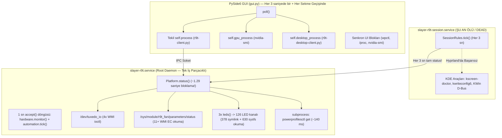

# Slayer R9T Kontrol Merkezi — Teknik İnceleme, Tasarım ve Mimari Analiz Raporu

Bu rapor, **Slayer R9T Kontrol Merkezi** ([`outputs/slayer_r9t/`](file:///home/chaple/Belgeler/kontrol%20merkezi%20linux/outputs/slayer_r9t/)) uygulamasının hem canlı sistem üzerindeki çalışma durumu (`/usr/local/lib/slayer-r9t/`, `systemd` servisleri, `r9t_fan` kernel modülü) hem de kaynak kod, görsel arayüz (19 sekme ve diyalog pencereleri) ve OEM referansları ([`work/oem-decompiled/`](file:///home/chaple/Belgeler/kontrol%20merkezi%20linux/work/oem-decompiled/)) taranarak hazırlanmıştır.

> [!CAUTION]
> **Canlı Sistemde Tespit Edilen En Kritik 4 Bulgular Özeti:**
> 1. **Arka Plan Gecikmesi ve Yüksek CPU Tüketimi (`~1.29 sn / status`):** Root servisi ([`slayer-r9t.service`](file:///etc/systemd/system/slayer-r9t.service)) tek bir `status` sorgusunu **~1.29 saniyede** yanıtlamakta ve önceki oturumda **1 saat 18 dakika CPU süresi** tüketmiştir. Her durum sorgusunda **15+ sıralı ACPI WMI EC okuması**, **3 kez 126 kanallı LED sysfs taraması (504 symlink + 630 dosya okuması)** ve senkron `powerprofilesctl` alt süreci çalıştırılmaktadır.
> 2. **Kullanıcı Oturum Servisinin Çökük Olması ve Hyprland Uyumsuzluğu:** Sistem şu anda **Hyprland (Wayland)** üzerinde çalışırken, [`slayer-r9t-session.service`](file:///etc/systemd/user/slayer-r9t-session.service) (`inactive / dead`) ve [`desktop.py`](file:///home/chaple/Belgeler/kontrol%20merkezi%20linux/outputs/slayer_r9t/desktop.py) tamamen **KDE Plasma 6** (`kscreen-doctor`, `kwriteconfig6`, `org.kde.KWin`) araçlarına bağımlıdır. Bu yüzden **Ekran**, **Cihazlar** ve **Otomasyon (`session_ready`)** sistemleri işlevsiz kalmaktadır.
> 3. **Görsel ve QSS Kırılmaları (Beyaz Üstüne Beyaz Diyaloglar, Kesilen Metinler, Beyaz Tablo):** [`LightingEditor`](file:///home/chaple/Belgeler/kontrol%20merkezi%20linux/outputs/slayer_r9t/gui.py#L32-L109) ve [`ProfileEditor`](file:///home/chaple/Belgeler/kontrol%20merkezi%20linux/outputs/slayer_r9t/gui.py#L111-L240) pencerelerinde açık gri arka plan üzerine beyaz metin (`#e8eff9`) basıldığı için yazılar okunamamaktadır; **Kaynaklar** sekmesinde süreç listeleri dikeyde 12 piksele sıkışıp kesilmekte, **Karşılaştırma** sekmesinde ise koyu tema ortasında bembeyaz `QTableWidget` yer almaktadır.
> 4. **19 Sekmeli Yatay Sekme Çubuğu Taşması ve Kurulu Sürüm Kayması:** Tek bir yatay `QTabBar` içine 19 sekme sıkıştırıldığı için 8 sekme taşma oklarının (`< >`) arkasına gizlenmektedir. Ayrıca `/usr/local/lib/slayer-r9t/` altındaki kurulu dosyalar (`0.10.1` / kısmi 10 Ekim yaması) ile depodaki `0.11.1` kaynak kodu birbirinden kopmuş durumdadır.

---

## 1. Görsel Kanıtlar (Canlı Arayüz Taraması)

Aşağıdaki karuselde uygulamanın mevcut kod tabanından alınan gerçek ekran görüntüleri ve tespit edilen görsel/tasarımsal bozukluklar yer almaktadır:

````carousel

<!-- slide -->

<!-- slide -->

<!-- slide -->

<!-- slide -->

<!-- slide -->

<!-- slide -->
![Ekran Sekmesi — Oturum servisi kapalıyken kullanıcıya doğrudan '[Errno 2] No such file or directory' ham Python hatası gösterilmesi ve takılı kalan GPU tanılama uyarısı](/home/chaple/.gemini/antigravity/brain/4b29a78d-eae5-4f48-b40f-463081fab2ce/tab_09.png)
````

---

## 2. Arka Plan Çalışma Sistemi ve Mimari Bozukluklar

### 2.1. Mevcut Mimari ve Darboğaz Akışı



### 2.2. Tespit Edilen Arka Plan (Backend) Problemleri

#### 1. `Platform.status()` Çağrısının ~1.29 Saniye Sürmesi ve Tek İş Parçacıklı Servisi Kilitlemesi
Canlı sistemde yapılan ölçümlerde `r9t-client.py status` çağrısı tutarlı olarak **1.285 – 1.297 saniye** sürmektedir:
- **Çift ve Gereksiz ACPI WMI EC Okuması (~850 ms):** [`Platform.status()`](file:///home/chaple/Belgeler/kontrol%20merkezi%20linux/outputs/slayer_r9t/hardware.py#L81-L92) önce `/dev/tuxedo_io` üzerinden 4 adet ioctl (`0x12`, `0x13` sıcaklık ve `0x10`, `0x11` ham fan PWM) okur. Hemen ardından 92. satırda [`self.fans.status()`](file:///home/chaple/Belgeler/kontrol%20merkezi%20linux/outputs/slayer_r9t/fans.py#L182-L189) çağrılarak `/sys/module/r9t_fan/parameters/status` okunur. Kernel modülündeki [`status_get()`](file:///home/chaple/Belgeler/kontrol%20merkezi%20linux/outputs/fan-driver/r9t_fan.c#L113-L128) aynı sıcaklıkları (`0x043e`, `0x044f`), aynı PWM kayıtlarını (`0x1804`, `0x1809`), mod baytını (`0x0751`) ve her iki fanın RPM değerini (`rpm()` içinde kararlılık için fan başına 3'er EC okuması = 6 okuma) tekrar ACPI WMI üzerinden okur. Tek bir `status` çağrısında **en az 15 sıralı ACPI WMI AML değerlendirmesi** yapılır.
- **Her `status` Çağrısında 3 Kez 126 Kanal RGB Sysfs Taraması (~95 ms):** [`Platform.status()`](file:///home/chaple/Belgeler/kontrol%20merkezi%20linux/outputs/slayer_r9t/hardware.py#L98-L113) içinde sırasıyla [`get_rgb()`](file:///home/chaple/Belgeler/kontrol%20merkezi%20linux/outputs/slayer_r9t/hardware.py#L308-L321), [`rgb_range_supported()`](file:///home/chaple/Belgeler/kontrol%20merkezi%20linux/outputs/slayer_r9t/hardware.py#L183-L191) ve [`perkey_available()`](file:///home/chaple/Belgeler/kontrol%20merkezi%20linux/outputs/slayer_r9t/hardware.py#L352-L355) çağrılır. Bu üç fonksiyonun her biri [`leds()`](file:///home/chaple/Belgeler/kontrol%20merkezi%20linux/outputs/slayer_r9t/hardware.py#L344-L349) fonksiyonunu baştan çalıştırır:
  - `3 × 126 = 378` kez `/sys/class/leds/rgb:kbd_backlight*/device/driver` sembolik bağı çözülür (`.resolve()`).
  - `126` kez `(p/'device').resolve()` çağrılır.
  - `126` kanal için `multi_index`, `multi_intensity`, `brightness`, `max_brightness` ve `multi_max_intensity` dosyaları (**630 dosya okuması**) her 3 saniyede bir tekrar tekrar okunur.
- **Her `status` Çağrısında Senkron `powerprofilesctl get` Alt Süreci (~140 ms):** [`get_power_profile()`](file:///home/chaple/Belgeler/kontrol%20merkezi%20linux/outputs/slayer_r9t/hardware.py#L287-L291) her seferinde yeni bir `/usr/bin/powerprofilesctl get` süreci başlatır (~140 ms).
- **`set_rgb_map` Sırasında 126 Kez Watchdog Soketi Açılıp Kapatılması:** [`set_rgb_map()`](file:///home/chaple/Belgeler/kontrol%20merkezi%20linux/outputs/slayer_r9t/hardware.py#L365-L376) ve [`set_rgb()`](file:///home/chaple/Belgeler/kontrol%20merkezi%20linux/outputs/slayer_r9t/hardware.py#L397-L408) döngülerinin içinde **her bir LED kanalı için (126 kez)** [`notify('WATCHDOG=1')`](file:///home/chaple/Belgeler/kontrol%20merkezi%20linux/outputs/slayer_r9t/hardware.py#L420-L426) çağrılmakta ve her çağrıda yeni bir `AF_UNIX` soketi oluşturulup kapatılmaktadır.

#### 2. Fan Köprüsü (`r9t_fan.c`), `Fans.monitor()` ve `TemperatureTarget.tick()` Arasında Üçlü EC Çakışması
Manuel fan, fan eğrisi veya sıcaklık hedefi açıkken üç ayrı zamanlayıcı aynı EC kayıtlarına eşzamanlı yüklenmektedir:
1. **Kernel Workqueue ([`r9t_fan.c:worker`](file:///home/chaple/Belgeler/kontrol%20merkezi%20linux/outputs/fan-driver/r9t_fan.c#L63-L78)):** Her **1 saniyede bir** `temperatures()` + `0x0751` okur ve `0x1804` / `0x1809` kayıtlarına PWM yazar.
2. **`Fans.monitor()` ([`fans.py`](file:///home/chaple/Belgeler/kontrol%20merkezi%20linux/outputs/slayer_r9t/fans.py#L149-L180)):** Her **2 saniyede bir** `self.read()` ile `status` dosyasını okur (11 EC okuması) ve hedef hiç değişmemiş olsa bile `self.send('manual ...')` ile `control` dosyasına yazar. [`control_set()`](file:///home/chaple/Belgeler/kontrol%20merkezi%20linux/outputs/fan-driver/r9t_fan.c#L79-L102) ise kernel tarafında tekrar sıcaklık/mod okur, PWM yazar ve `mod_delayed_work` ile kernel zamanlayıcısını sıfırlar.
3. **`TemperatureTarget.tick()` ([`temperature_target.py`](file:///home/chaple/Belgeler/kontrol%20merkezi%20linux/outputs/slayer_r9t/temperature_target.py#L132-L185)):** Her **2 saniyede bir** `self.fans.status()` çağırarak `status` dosyasını **bir kez daha** okur (11 EC okuması daha) ve fan hedefi değiştiğinde `update_manual_targets()` ile `control` dosyasına tekrar yazar.

#### 3. `slayer-r9t-session.service` Çökmesi, Hyprland Uyumsuzluğu ve Otomasyon Kilidi
- **Hyprland vs. KDE Plasma Çatışması:** Kullanıcının aktif masaüstü oturumu **Hyprland** (`XDG_CURRENT_DESKTOP=Hyprland`) olmasına karşın, [`desktop.py`](file:///home/chaple/Belgeler/kontrol%20merkezi%20linux/outputs/slayer_r9t/desktop.py) içindeki ekran (`kscreen-doctor`), gece rengi (`kwriteconfig6` / `org.kde.KWin.NightLight`), touchpad (`org.kde.KWin.InputDevice`) ve klavye (`kxkbrc` + `org.kde.KWin.reconfigure`) fonksiyonlarının tamamı KDE Plasma'ya özeldir.
- **Otomasyonun Sessizce Devre Dışı Kalması:** [`SessionRules.tick()`](file:///home/chaple/Belgeler/kontrol%20merkezi%20linux/outputs/slayer_r9t/session.py#L51-L52) başlangıçta `desktop.screens()` (`kscreen-doctor -j`) çağrısı başarılı olmadan root servise `session_ready` göndermez. Root servisteki [`Automation.tick()`](file:///home/chaple/Belgeler/kontrol%20merkezi%20linux/outputs/slayer_r9t/automation.py#L94) ise `if not self.session or self.paused: return` kontrolü yaptığı için, KDE ekran servisi yanıt vermediğinde **uygulama ve güç otomasyonu tamamen çalışmaz hale gelir**.
- **GUI Kapalıyken Bile Her 3 Saniyede Tam `status` Sorgusu:** [`SessionRules.tick()`](file:///home/chaple/Belgeler/kontrol%20merkezi%20linux/outputs/slayer_r9t/session.py#L53) yalnızca `state['automation']` alanını okumak için her 3 saniyede bir `request({'op': 'status'})` çağırır. Bu da GUI kapalıyken bile root servisini her 3 saniyede bir 1.29 saniyelik tam donanım sorgusuna zorlar.
- **Boş Kural Listesinde Gereksiz `/proc` Taraması:** [`Automation.tick()`](file:///home/chaple/Belgeler/kontrol%20merkezi%20linux/outputs/slayer_r9t/automation.py#L99) içinde `rules['apps']` boş (`[]`) olsa dahi, otomasyon açıkken her saniye [`executables(self.uid)`](file:///home/chaple/Belgeler/kontrol%20merkezi%20linux/outputs/slayer_r9t/automation.py#L17-L24) çağrılarak `/proc` altındaki tüm süreçler taranmaktadır.

#### 4. GUI `QProcess` Kuyruk Tıkanması, Yarış Durumları ve Ana İş Parçacığı (UI Thread) Bloklamaları
- **Tekil `self.process` Kuyruk Tıkanması:** [`ControlCenter.command()`](file:///home/chaple/Belgeler/kontrol%20merkezi%20linux/outputs/slayer_r9t/gui.py#L1109-L1129) hem periyodik `status` sorgusu hem de kullanıcı aksiyonları için tek bir `self.process` kullanır. `status` sorgusu 1.29 sn sürdüğü için zamanın %43'ünde kanal meşguldür. Örneğin kullanıcı **"Turbo"** senaryosuna tıkladığında ([`scenario_turbo`](file:///home/chaple/Belgeler/kontrol%20merkezi%20linux/outputs/slayer_r9t/gui.py#L669-L676)), 4 ayrı komut (`power`, `boost`, `profile`, `fan_boost`) sırayla kuyruğa girer; her biri ayrı bir Python süreci başlatır ve her birinin sonunda root servisi tam `self.status()` hesaplar. Tek bir buton tıklaması **5 ila 7 saniye** sürer.
- **`QProcess.kill()` Sonrası Silinmiş C++ Nesnesine Erişim (`libshiboken RuntimeError`):** [`poll()`](file:///home/chaple/Belgeler/kontrol%20merkezi%20linux/outputs/slayer_r9t/gui.py#L1348) içinde `GPU neden açık?` sekmesine geçildiğinde veya zaman aşımı olduğunda `process.kill()` çağrılır. Bu durumda hem `errorOccurred` hem `finished` sinyali tetiklenir; ilk sinyal `process.deleteLater()` çalıştırdıktan sonra ikinci sinyal silinmiş C++ `QProcess` nesnesinden çıktı okumaya çalışarak `RuntimeError: Internal C++ object (PySide6.QtCore.QProcess) already deleted` hatası üretir.
- **Sekme Değişiminde `poll()` Fırtınası ve `CpuUsage` Sıfırlanması:** [`gui.py:311`](file:///home/chaple/Belgeler/kontrol%20merkezi%20linux/outputs/slayer_r9t/gui.py#L311) satırındaki `self.tabs.currentChanged.connect(lambda _: self.poll())` nedeniyle her sekme geçişinde `poll()` çağrılır. [`CpuUsage.read()`](file:///home/chaple/Belgeler/kontrol%20merkezi%20linux/outputs/slayer_r9t/telemetry.py#L85-L94) iki okuma arasında geçen süre çok kısa olduğunda (`total == previous[1]`) `None` döndürür; bu da **İşlemci kullanımı** kartının `— (VERİ YOK)` göstermesine ve `Sparkline` / `History` zaman serilerine bozuk aralıklarla örnek eklenmesine yol açar.
- **UI İş Parçacığını Donduran Senkron Alt Süreçler:**
  - [`AudioPanel`](file:///home/chaple/Belgeler/kontrol%20merkezi%20linux/outputs/slayer_r9t/audio_widget.py#L61-L92): Uygulama açılışında (`__init__`) ve her ses kaydırıcısı bırakıldığında ana UI iş parçacığında 4 ila 6 kez senkron `wpctl` alt süreci çalıştırır.
  - [`ProcessesPanel`](file:///home/chaple/Belgeler/kontrol%20merkezi%20linux/outputs/slayer_r9t/processes_widget.py#L69-L73): Sekme açıkken her 5 saniyede bir tüm `/proc` taramasını ve `nvidia-smi --query-compute-apps` alt sürecini doğrudan ana UI iş parçacığında (`subprocess.run`) çalıştırır.

#### 5. Kurulu Sistem (`/usr/local/lib/slayer-r9t`) ile Kaynak Kod (`outputs/`) Tutarsızlığı
- `/usr/local/lib/slayer-r9t` içindeki üst seviye betikler 3 Ekim (`0.10.1`) tarihli iken, `slayer_r9t/` paketindeki bazı dosyalar 10 Ekim'de güncellenmiş; ancak `sleepdiag.py` ve `sleepdiag_widget.py` kurulu dizinde mevcut değildir.
- Tersine, kurulu `/usr/local/lib/slayer-r9t/slayer_r9t/cooling.py` içinde `sweet_spot` (`Sweet Spot · Ölçülmüş dengeli performans`) hazır profili yer alırken, depodaki [`outputs/slayer_r9t/cooling.py`](file:///home/chaple/Belgeler/kontrol%20merkezi%20linux/outputs/slayer_r9t/cooling.py#L190-L199) dosyasından bu profil düşmüştür.

---

## 3. Tasarımsal Sorunlar ve Sekme (Tab) Mimarisi İncelemesi

### 3.1. Sekme Bazlı Detaylı Denetim Tablosu (19 Sekme)

| # | Sekme Adı | Mevcut İçerik | Tespit Edilen Tasarım, UX ve Çalışma Sorunları |
| :--- | :--- | :--- | :--- |
| **00** | **Genel durum** | Senaryo butonları, 6 `MetricCard`, özet satırı, EC oto fan kartı | • İlk açılışta ve hızlı yenilemede **İşlemci kullanımı** `— (VERİ YOK)` gösterir.<br>• `MetricCard` altındaki `Min / Maks` metni ilk örneklerde sağdan kırpılır (`Min 66°C / Maks`).<br>• Senaryo durumu (`Özel karışım`) gerçek fan modunu kontrol etmez (`fan_mode` değişkeni [`gui.py:1220`](file:///home/chaple/Belgeler/kontrol%20merkezi%20linux/outputs/slayer_r9t/gui.py#L1220) satırında okunup hiç kullanılmaz!). |
| **01** | **Güç ve işlemci** | Linux güç profili, CPU boost, AMD P-State EPP | • Kontroller 1130px boyunca tam genişlikte yayılır.<br>• `Serin çalışma` sekmesindeki CPU ayarlarıyla bölünmüş durumdadır; kullanıcı CPU frekansı için başka sekmeye, boost/EPP için bu sekmeye gitmek zorundadır. |
| **02** | **Fanlar** | CPU/GPU RPM kartları, Fan modu, Manuel hızlar, 4 noktalı eğri | • Fan eğrisi görsel bir grafik değil, alt alta dizilmiş 8 adet `QSpinBox` kutusudur.<br>• `CPU fanı` ve `GPU fanı` kartlarında `Sparkline` `upper=6500` olmasına rağmen `MetricIcon` olarak fan ikonu yerine `chip` (işlemci) ikonu kullanılmıştır ([`gui.py:708`](file:///home/chaple/Belgeler/kontrol%20merkezi%20linux/outputs/slayer_r9t/gui.py#L708)). |
| **03** | **Serin çalışma** | Hızlı oyun modu, Hazır soğutma profilleri, Sıcaklık hedefi, CPU/GPU MHz sınırları, Undervolt notu | • `Genel durum` sekmesindeki senaryo butonları (`Sessiz`, `Dengeli`, `Oyun`) ile buradaki `Hızlı oyun modu` ve `Hazır soğutma profilleri` birbirini tekrar eder.<br>• Çok fazla dikey kart (`6 ayrı Card`) alt alta yığıldığı için uzun dikey kaydırma gerektirir. |
| **04** | **Dynamic Boost** | Firmware/daemon durumu, CPU/GPU watt kartları, 2× `HistoryPlot` | • Alttaki iki grafikte (`HistoryPlot`) Y-ekseni üst sınır değeri (`100` / `150`) ile birim etiketi (`W`) sol üst köşede **üst üste biner** ([`widgets.py:252-253`](file:///home/chaple/Belgeler/kontrol%20merkezi%20linux/outputs/slayer_r9t/widgets.py#L252-L253)). |
| **05** | **GPU neden açık?** | DRM konektörleri, Runtime D3 durumu ve açık dosya tutan süreçler | • Bu sekmeye girildiğinde üstteki durum çubuğu `"GPU tanılaması · düzenli NVIDIA ve servis durum sorguları duraklatıldı."` olur; başka sekmeye geçildiğinde `status` yanıtı gelene kadar (veya `self.process` meşgulse) bu uyarı diğer sekmelerde de asılı kalır.<br>• Çıktı yapılandırılmış tablo/rozet yerine ham düz metin (`QTextEdit`) olarak basılır. |
| **06** | **Klavye** | Tek renk RGB, parlaklık, hazır desenler, `LightingEditor`, Fn Lock, KDE XKB | • **"Renk düzenini düzenle"** (`LightingEditor`) açıldığında açık gri arka plan üstüne beyaz yazı nedeniyle tüm açıklamalar ve satır/sütun sayıları **görünmezdir**.<br>• Hem "Klavyeye uygula" (tek renk) hem "Seçilen renk düzenini uygula" (desen/harita) aynı kartta alt alta durduğu için hangi butonun neyi uyguladığı kafa karıştırıcıdır.<br>• KDE tuş atama butonları Hyprland altında çalışmaz. |
| **07** | **Profiller** | Profil seçimi, önizleme, kaydet/düzenle/kopyala/uygula/sil, içe/dışa aktar | • **"Seçilen profili düzenle / kopyala"** (`ProfileEditor`) açıldığında açık gri arka plan üstüne beyaz yazı nedeniyle onay kutusu metinleri **okunamaz**.<br>• "Seçimleri yeni profil olarak kaydet" butonu, o sırada diğer sekmelerde (`Güç`, `Serin çalışma`, `Klavye`, `Fanlar`) seçili olan taslak değerlerini toplar; kullanıcının hangi sekmede ne bıraktığını bilmesi zordur. |
| **08** | **Pil** | Pil seviyesi, sağlık, döngü, voltaj/akım/güç, şarj sınırı açıklaması | • Şarj sınırı desteklenmediği için sekmede yalnızca **tek bir kart ve 4 satır salt okunur metin** vardır; ekranın %80'i boştur. |
| **09** | **Ekran** | Ekran/Hz seçimi, parlaklık, KDE gece rengi, ICC profili | • Oturum servisi kapalıyken veya Hyprland altında doğrudan `[Errno 2] No such file or directory` ham hatasını gösterir.<br>• Parlaklık kontrolü `kscreen-doctor` üzerinden yapıldığı için Hyprland'da çalışmaz (oysa `/sys/class/backlight` veya `brightnessctl` kullanılabilir). |
| **10** | **Otomasyon** | Açılış/priz/pil kuralları, uygulama listesi, düşük Hz, ışık zaman aşımı | • 8 adet tam genişlikte buton ve 3 açılır menü tek bir kart içine sıkıştırılmıştır.<br>• `session_ready` KDE'ye bağımlı olduğu için Hyprland'da kurallar devreye girmez.<br>• Steam oyunları ipucu metni olarak listelenir ancak listeden seçip doğrudan kural ekleme imkânı yoktur. |
| **11** | **Cihazlar** | Kamera, Wi-Fi, Bluetooth, Touchpad, Uçak modu, OEM destek metni | • Kamera root servisinden, Wi-Fi/BT/Touchpad ise masaüstü oturum servisinden yönetilir. Masaüstü servisi kapalıyken `[Errno 2] No such file or directory` yazar ve Wi-Fi/BT (`nmcli`/`busctl` masaüstünden bağımsız olduğu halde!) devre dışı kalır. |
| **12** | **Tanılama** | Ham JSON (`report()`) ve dışa aktarma | • Kullanıcıya biçimlendirilmemiş yüzlerce satırlık ham JSON metni gösterir; `events` (işlem geçmişi) yalnızca bir aksiyon sonrasında veya "İşlem geçmişini yenile" butonuna basıldığında yüklenir, sekme açıldığında otomatik çekilmez. |
| **13** | **Ölçüm geçmişi** | Metrik ve 5/30 dk seçimi, `HistoryPlot`, CSV aktarımı | • Y-ekseni birim etiketi (`°C`, `W`, `RPM`) en üst değerle çakışır.<br>• Sekmeler arası her geçişte `poll()` çağrıldığı için örnekleme sıklığı bozulur. |
| **14** | **Karşılaştırma** | A/B ölçüm başlat/durdur, `QTableWidget`, CSV aktarımı | • `Card` bileşeni içine alınmamıştır.<br>• **`QTableWidget` tamamen stilsizdir (bembeyaz arka plan, siyah yazı)**; ilk sütun dar kaldığı için metrik adları `CPU sıcaklığı ...` şeklinde kesilir. |
| **15** | **SSD ve RAM** | NVMe ve `spd5118` RAM sıcaklık kartları | • Sadece 4 adet sıcaklık kartı içerir; `Genel durum` veya `Donanım İzleme` altında birleştirilebilir. |
| **16** | **Kaynaklar** | En çok CPU, RAM ve GPU (VRAM) kullanan süreçler | • **İlk açılışta kart yükseklikleri `'—'` metnine göre kilitlenir ve 8 satırlık süreç listesi dikeyde kesilir.**<br>• `nvidia-smi --query-compute-apps` yalnızca CUDA (`C`) süreçlerini gösterir; Vulkan/OpenGL (`G`) oyun ve uygulamaları göstermez. |
| **17** | **Ses** | Çıkış ve mikrofon aygıt seçimi, ses düzeyi, susturma | • Hem çıkış hem giriş aygıtı PipeWire'da aynı ada (`Ryzen HD Audio Controller Analog Stereo`) sahip olduğunda ayırt edici bilgi (ID / profil) göstermez.<br>• Sekme açıkken otomatik yenileme (`QTimer`) yoktur; klavyeden ses değiştirildiğinde kaydırıcı güncellenmez. |
| **18** | **Uyku ve pil** | Uykuya hazırlan ve Karşılaştır butonları | • Yalnızca tek bir küçük kart ve 2 butondan oluşur; `Pil` sekmesiyle ayrı durması sekme kalabalığını artırır. |

---

### 3.2. Önerilen Sekme ve Navigasyon Mimarisi (19 Sekmeden 6 Ana Modüle Dönüşüm)

Mevcut **19 yatay sekme**, bilişsel yükü artırmakta ve pencereye sığmamaktadır. Bunun yerine sol dikey kenar çubuğu (**Sidebar Navigation**) veya **6 ana kategori** yapısına geçilmelidir:

```mermaid
flowchart LR
    subgraph MEVCUT["Mevcut Yapı: 19 Yatay Sekme (Taşma & Dağınıklık)"]
        direction TB
        T1["00 Genel durum | 01 Güç ve işlemci | 02 Fanlar | 03 Serin çalışma | 04 Dynamic Boost"]
        T2["05 GPU neden açık? | 06 Klavye | 07 Profiller | 08 Pil | 09 Ekran | 10 Otomasyon"]
        T3["11 Cihazlar | 12 Tanılama | 13 Ölçüm geçmişi | 14 Karşılaştırma | 15 SSD ve RAM"]
        T4["16 Kaynaklar | 17 Ses | 18 Uyku ve pil"]
    end

    subgraph HEDEF["Önerilen Yapı: 6 Ana Modül (Sol Kenar Çubuğu + Alt Bölümler)"]
        direction TB
        M1["1. Gösterge Paneli (Dashboard)<br/>• Hızlı Senaryolar (Sessiz / Dengeli / Oyun / Turbo)<br/>• CPU, GPU, Fan, Pil, SSD/RAM Özet Kartları"]
        M2["2. Performans ve Soğutma<br/>• Güç Profili, CPU Boost, EPP ve MHz Sınırları<br/>• İnteraktif Fan Eğrisi, Manuel Hız ve Sıcaklık Hedefi<br/>• Dynamic Boost Durumu ve Güç Tavanı"]
        M3["3. Profiller ve Otomasyon<br/>• Kayıtlı Profiller (Birleşik Düzenleyici)<br/>• Güç Kaynağı ve Uygulama/Steam Otomasyon Kuralları"]
        M4["4. Klavye ve Aydınlatma<br/>• Tek Renk, Hazır Desenler ve 6×21 Tuş Haritası<br/>• Fn Lock ve Boşta Işık Zaman Aşımı"]
        M5["5. Cihaz, Ekran ve Ses<br/>• Ekran Hz/Parlaklık/Gece Işığı (KDE + Hyprland)<br/>• Ses/Mikrofon (PipeWire), Kamera, Wi-Fi, BT, Touchpad"]
        M6["6. İzleme ve Tanılama<br/>• Ölçüm Geçmişi ve A/B Profil Karşılaştırma<br/>• Kaynak Kullanan Süreçler & GPU Uyandırma Analizi<br/>• Pil/Uyku Analizi ve Sistem Tanılama Günlüğü"]
    end

    MEVCUT ==> HEDEF
```



---

## 4. Eksiklikler ve Kapsam Boşlukları (Donanım & Masaüstü)

1. **Hyprland / Genel Wayland Masaüstü Adaptörü Eksikliği ([`desktop.py`](file:///home/chaple/Belgeler/kontrol%20merkezi%20linux/outputs/slayer_r9t/desktop.py), [`session.py`](file:///home/chaple/Belgeler/kontrol%20merkezi%20linux/outputs/slayer_r9t/session.py)):**
   - **Ekran Modu ve Hz:** KDE'de `kscreen-doctor`, Hyprland'da `hyprctl monitors -j` ve `hyprctl keyword monitor` (veya `wlr-randr`) ile çalıştırılmalıdır.
   - **Ekran Parlaklığı:** Masaüstü ortamından bağımsız olarak `/sys/class/backlight/` (veya `brightnessctl`) üzerinden doğrudan donanım seviyesinde okunup yazılabilir.
   - **Wi-Fi ve Bluetooth:** `nmcli` ve `busctl org.bluez` zaten masaüstünden bağımsızdır; KDE ekran sorgusu başarısız oldu diye Wi-Fi/Bluetooth kontrollerinin kilitlenmesi mimari bir hatadır.
   - **Boşta Kalma (Idle) Algılama:** `session-idle.cpp` yalnızca `KF6IdleTime` kullanır; Wayland `ext-idle-notify-v1` protokolü desteklenmeli veya oturum servisi `kscreen-doctor` hatasında `session_ready` bildirimini engellememelidir.
2. **GPU Grafik Süreçlerinin Görünmemesi ([`processes.py:100`](file:///home/chaple/Belgeler/kontrol%20merkezi%20linux/outputs/slayer_r9t/processes.py#L100)):**
   - `nvidia-smi --query-compute-apps` yalnızca CUDA/Compute süreçlerini listeler. Oyunlar, tarayıcılar ve Wayland композиtörü grafik (`G`) süreci olduğu için listede çıkmaz. NVML (`nvmlDeviceGetGraphicsRunningProcesses` + `nvmlDeviceGetComputeRunningProcesses`) veya `nvidia-smi pmon` kullanılmalıdır.
3. **Görsel Fan Eğrisi ve Klavye Haritası Kullanılabilirliği:**
   - **Fan Eğrisi:** 8 adet `QSpinBox` yerine fareyle sürüklenebilir 2B Sıcaklık (°C) – Fan (%) grafiği ve üzerinde anlık CPU/GPU sıcaklık noktasını gösteren canlı imleç eklenmelidir.
   - **Klavye 6×21 Matrisi ([`LightingEditor`](file:///home/chaple/Belgeler/kontrol%20merkezi%20linux/outputs/slayer_r9t/gui.py#L32-L109)):** Fareyi basılı tutarak boyama (drag-to-paint) ve en azından temel tuş bölgeleri (ESC, F1–F12, WASD, Boşluk, Oklar, Numpad) için görsel rehber eklenmelidir.
4. **Steam Oyunlarından Tek Tıkla Otomasyon Kuralı Ekleme ([`games.py`](file:///home/chaple/Belgeler/kontrol%20merkezi%20linux/outputs/slayer_r9t/games.py)):**
   - `games.py` Steam kütüphanesindeki 32 oyunu bulmakta ancak bunu yalnızca `Otomasyon` sekmesinde bir ipucu cümlesi (`app_hint`) olarak göstermektedir. Kullanıcı oyun çalışmıyorken bile Steam listesinden oyunu seçip yürütülebilir dosyasını bağlayabilmelidir.
5. **Sistem Tepsisi (System Tray) Davranışı ([`gui.py:565-577`](file:///home/chaple/Belgeler/kontrol%20merkezi%20linux/outputs/slayer_r9t/gui.py#L565-L577), [`closeEvent`](file:///home/chaple/Belgeler/kontrol%20merkezi%20linux/outputs/slayer_r9t/gui.py#L1595-L1603)):**
   - Pencere kapatıldığında (`closeEvent`) uygulama tamamen kapanmakta ve tepsi ikonu da yok olmaktadır. Tepsiye küçültme (minimize to tray) seçeneği ve tepsi menüsünde anlık CPU/GPU sıcaklığı + etkin senaryo gösterimi eksiktir.

---

## 5. Önceliklendirilmiş Çözüm ve İyileştirme Yol Haritası

| Öncelik | İş Paketi | Kapsam ve Dosyalar | Beklenen Etki |
| :--- | :--- | :--- | :--- |
| **P0 — Kritik (Arka Plan & Çökme)** | **Root Servis `status` Optimizasyonu ve Önbellekleme** | [`hardware.py`](file:///home/chaple/Belgeler/kontrol%20merkezi%20linux/outputs/slayer_r9t/hardware.py), [`fans.py`](file:///home/chaple/Belgeler/kontrol%20merkezi%20linux/outputs/slayer_r9t/fans.py), [`service.py`](file:///home/chaple/Belgeler/kontrol%20merkezi%20linux/outputs/slayer_r9t/service.py) | • `Platform.status()` içindeki mükerrer `/dev/tuxedo_io` okumalarını kaldırıp `r9t_fan` verisini kullanmak.<br>• Statik LED yeteneklerini (`perkey_available`, `rgb_range_supported`) başlangıçta 1 kez, `get_rgb()` durumunu ise önbellekli okumak.<br>• `status` süresini **1.29 saniyeden <80 milisaniyeye** düşürmek ve arka plan CPU kullanımını %90 azaltmak. |
| **P0 — Kritik (Görsel & QSS)** | **Diyalog, Tablo ve Kart Kırılmalarının Düzeltilmesi** | [`widgets.py`](file:///home/chaple/Belgeler/kontrol%20merkezi%20linux/outputs/slayer_r9t/widgets.py), [`gui.py`](file:///home/chaple/Belgeler/kontrol%20merkezi%20linux/outputs/slayer_r9t/gui.py), [`processes_widget.py`](file:///home/chaple/Belgeler/kontrol%20merkezi%20linux/outputs/slayer_r9t/processes_widget.py), [`compare_widget.py`](file:///home/chaple/Belgeler/kontrol%20merkezi%20linux/outputs/slayer_r9t/compare_widget.py) | • `QDialog`, `QLineEdit`, `QTableWidget`, `QHeaderView` ve `QScrollArea > QWidget` için koyu tema QSS kurallarını eklemek (beyaz üstüne beyaz yazıları ve beyaz tabloyu gidermek).<br>• `ProcessesPanel` kart yükseklik kilitlenmesini, `MetricCard` `Min/Maks` kırpılmasını, `HistoryPlot` Y-ekseni çakışmasını ve başlık satır kaymasını düzeltmek. |
| **P1 — Yüksek (Oturum & Hyprland)** | **Masaüstü Servisi Hyprland Desteği ve Bağımsızlaştırma** | [`desktop.py`](file:///home/chaple/Belgeler/kontrol%20merkezi%20linux/outputs/slayer_r9t/desktop.py), [`session.py`](file:///home/chaple/Belgeler/kontrol%20merkezi%20linux/outputs/slayer_r9t/session.py), [`install-r9t.py`](file:///home/chaple/Belgeler/kontrol%20merkezi%20linux/outputs/install-r9t.py) | • `session_ready` sinyalini `kscreen-doctor` başarısından ayırmak (otomasyonun Hyprland'da da çalışmasını sağlamak).<br>• Hyprland ekran (`hyprctl monitors -j`), parlaklık (`/sys/class/backlight`), touchpad ve XKB adaptörlerini eklemek.<br>• `SessionRules.tick()` için hafif `automation_status` RPC'si eklemek. |
| **P1 — Yüksek (GUI Akıcılığı)** | **Asenkron İş Parçacığı ve `QProcess` Yaşam Döngüsü** | [`gui.py`](file:///home/chaple/Belgeler/kontrol%20merkezi%20linux/outputs/slayer_r9t/gui.py), [`audio_widget.py`](file:///home/chaple/Belgeler/kontrol%20merkezi%20linux/outputs/slayer_r9t/audio_widget.py), [`processes_widget.py`](file:///home/chaple/Belgeler/kontrol%20merkezi%20linux/outputs/slayer_r9t/processes_widget.py) | • `status` sorgusu ile kullanıcı aksiyon komutlarının `QProcess` kanallarını ayırmak; çoklu komutları (`scenario_turbo`, `game_mode_on`) tek bir atomik `profile` çağrısında birleştirmek.<br>• `QProcess.kill()` sonrası çift sinyal (`libshiboken`) çökmesini önlemek.<br>• Sekme değişiminde `poll()` fırtınasını ve `CpuUsage` `VERİ YOK` düşüşünü engellemek. |
| **P2 — Orta (UX & Sekme Yapısı)** | **19 Sekmenin 6 Ana Modülde Birleştirilmesi** | [`gui.py`](file:///home/chaple/Belgeler/kontrol%20merkezi%20linux/outputs/slayer_r9t/gui.py), [`widgets.py`](file:///home/chaple/Belgeler/kontrol%20merkezi%20linux/outputs/slayer_r9t/widgets.py) | • Sol kenar çubuğu (Sidebar) veya 6 gruplu sekme mimarisine geçerek taşma oklarını (`< >`) tamamen ortadan kaldırmak.<br>• Birincil aksiyon butonlarına `#primary` stilini uygulamak ve form kontrollerini hizalamak. |
| **P3 — Geliştirme** | **Görsel Fan Eğrisi, Grafik GPU Süreçleri ve Kurulum Senkronizasyonu** | [`processes.py`](file:///home/chaple/Belgeler/kontrol%20merkezi%20linux/outputs/slayer_r9t/processes.py), [`cooling.py`](file:///home/chaple/Belgeler/kontrol%20merkezi%20linux/outputs/slayer_r9t/cooling.py), [`install-r9t.py`](file:///home/chaple/Belgeler/kontrol%20merkezi%20linux/outputs/install-r9t.py) | • `sweet_spot` profilini kaynak koda geri eklemek ve `/usr/local/lib/slayer-r9t` kurulumunu güncel kodla senkronize etmek.<br>• `ProcessesPanel` içine grafik (`G`) GPU süreçlerini eklemek ve interaktif fan eğrisi bileşeni tasarlamak. |
