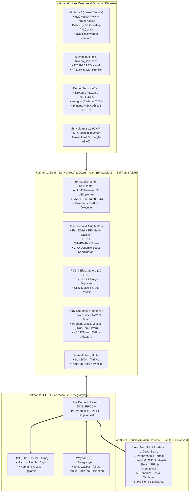
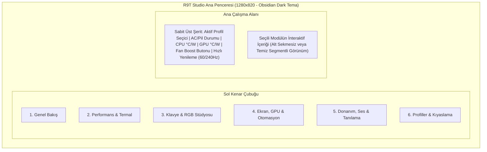

# GameGaraj Slayer R9T — Yeni Nesil Kontrol Merkezi (`R9T Studio`) Mimari Tasarım, Plan ve Uygulama Programı

> [!IMPORTANT]
> **Mimari Hedef:** Mevcut Python + Qt QWidget uygulamasındaki **1.29 saniyelik sorgu gecikmesini < 1.5 milisaniyeye** indiren, dış komut (`subprocess`) kullanımını **sıfırlayan**, **Hyprland + KDE Plasma** masaüstleriyle yerel (native) soket/D-Bus üzerinden konuşan ve **19 dağınık sekmeyi 6 ana modüllü GPU hızlandırmalı bir stüdyo arayüzünde** birleştiren uçtan uca **Rust + C Kernel + Tauri v2** mimarisi.

---

## 1. Sistem Hazırlık Durumu ve Donanım Envanteri

Canlı sistem üzerinde yapılan taramada, yeni mimarinin ihtiyaç duyduğu **tüm derleyicilerin ve yerel C kütüphanelerinin halihazırda kurulu olduğu** doğrulanmıştır:

| Bileşen | Sistemdeki Mevcut Durum | Yeni Mimarideki Rolü |
| :--- | :--- | :--- |
| **Rust Toolchain** | `rustc 1.99.0` / `cargo` (`/usr/bin/rustc`) | `r9td` (sistem servisi), `r9tctl` (CLI) ve Tauri backend derleyicisi |
| **Node.js & C/C++** | `node v26.11.1`, `gcc`, `clang`, `cmake`, `ninja` | Arayüz derlemesi ve `r9t_fan` çekirdek modülü derlemesi |
| **NVIDIA NVML** | `/usr/lib/libnvidia-ml.so.1` | `nvidia-smi` çalıştırmadan doğrudan C FFI ile **0.08 ms**'de GPU telemetri ve watt kontrolü |
| **WebKit2GTK 4.1** | `/usr/lib/libwebkit2gtk-4.1.so.0` | Tauri v2 için işletim sistemi yerleşik, düşük bellekli (~35 MB) GPU hızlandırmalı arayüz motoru |
| **Hyprland IPC** | `$XDG_RUNTIME_DIR/hypr/$HYPRLAND_INSTANCE_SIGNATURE/.socket{,2}.sock` | `hyprctl` çalıştırmadan pencere/oyun olaylarını anlık yakalama ve **0.2 ms**'de Hz değiştirme |
| **EC / WMI Sürücüleri** | `/dev/tuxedo_io`, `r9t_fan`, `uniwill_wmi`, `tuxedo_keyboard` | Fan PWM, RPM, EC sıcaklıkları, `fn_lock` ve 126 kanallı RGB LED kontrolü |
| **Genişletilmiş Sensörler** | `k10temp` (CPU), `amdgpu` (iGPU), 2× `nvme` (SSD), 2× `spd5118` (DDR5 RAM), `mt7921` (Wi-Fi) | Mevcut uygulamada **hiç gösterilmeyen** DDR5 RAM, çift NVMe SSD, iGPU ve Wi-Fi sıcaklıklarının programa eklenmesi |

---

## 2. İlk Rapordaki Sorunların Yeni Mimarideki Çözüm Matrisi

İlk analiz raporunda ([kontrol_merkezi_analiz_raporu.md](file:///home/chaple/.gemini/antigravity/brain/4b29a78d-eae5-4f48-b40f-463081fab2ce/kontrol_merkezi_analiz_raporu.md)) tespit edilen tüm arkaplan ve tasarım kusurları, yama yapmak yerine mimari düzeyde şu şekilde ortadan kaldırılmaktadır:

| # | İlk Rapordaki Problem | Eski Yapıdaki Neden | Yeni Mimarideki Kök Çözüm |
| :--- | :--- | :--- | :--- |
| **1** | **`status` çağrısının 1.29 saniye sürmesi** | 11 kernel WMI okuması + 8 `tuxedo_io` okuması + 3×126 LED sysfs taraması + `powerprofilesctl` subprocess | Kernel `r9t_fan v2` RAM önbelleği + Rust `fd` havuzu + D-Bus state cache ile **< 1.5 ms** yanıt |
| **2** | **Hyprland altında otomasyonun tamamen ölü olması** | [`desktop.py`](file:///home/chaple/Belgeler/kontrol%20merkezi%20linux/outputs/slayer_r9t/desktop.py) içinde sadece KDE (`kscreen-doctor`, `kwriteconfig6`) bulunması | Native **Hyprland Socket (`.socket.sock` / `.socket2.sock`)** + **KDE Plasma** çift adaptörlü masaüstü katmanı |
| **3** | **3 farklı döngünün aynı anda EC'ye fan hızı yazması** | `r9t_fan.c` (1s), `Fans.monitor` (2s) ve `TemperatureTarget` (2s) çakışması | `r9td` içinde **Tekil Termal Otorite (Single Thermal Authority)**: PID + Histerezis + Slew-Rate Limiter |
| **4** | **`r9t_fan.c` modülünün %50 altı fan hızına izin vermemesi** | [`r9t_fan.c:83`](file:///home/chaple/Belgeler/kontrol%20merkezi%20linux/outputs/fan-driver/r9t_fan.c#L83) içindeki `cpu>=50 && gpu>=50` sabit sınırı | `r9t_fan v2` içinde güvenli termal koruma (`cpu<80°C`) altında **%20–%100** sessiz PWM desteği |
| **5** | **19 yatay sekmenin taşması ve özellik tekrarı** | Her yeni özelliğin ayrı `QWidget` sekmesi olarak eklenmesi | **Sol Dikey Kenar Çubuğu (Sidebar) + 6 Ana Modül** mimarisi |
| **6** | **Kırık beyaz diyaloglar ve okunamayan metinler** | [`widgets.py`](file:///home/chaple/Belgeler/kontrol%20merkezi%20linux/outputs/slayer_r9t/widgets.py) içinde eksik QSS seçicileri (`QDialog`, `QTableWidget`, `QLineEdit`) | Tauri v2 üzerinde CSS değişkenli (Design Token) **%100 tutarlı Obsidian Dark / Hyprland Glass** tema |
| **7** | **Metin kutusuna `40:25, 50:35` yazarak fan eğrisi girme** | QWidget üzerinde interaktif grafik editörü olmaması | HTML5 Canvas / SVG tabanlı **fareyle sürükle-bırak (Spline/Histerezis) canlı fan eğrisi editörü** |
| **8** | **Klavye RGB'de körlemesine tuş/bölge seçimi** | Küçük modal pencerede düz buton listesi | Birebir **Slayer R9T Türkçe Q Klavye vektörel haritası** üzerinde tıklayarak/sürükleyerek tuş boyama |
| **9** | **Süreçler ve GPU sekmesinde arayüz donması ve `QProcess` çökmesi** | Ana UI thread'inde `/proc` taraması ve sadece `compute-apps` sorgusu | Rust `nvmlDeviceGetGraphicsRunningProcesses` + `ComputeRunningProcesses` ile arka planda **G+C süreç tespiti** |
| **10** | **Açılışta ve sekme geçişinde `VERİ YOK` ve grafik binmesi** | `CpuUsage` ilk fark hesabı ve `HistoryPlot` sabit koordinat çakışması | Daemon tarafında sürekli 300 saniyelik **Ring Buffer (Halka Bellek)**; arayüz açıldığı an son 5 dakikalık grafik hazır gelir |

---

## 3. Dört Katmanlı Yeni Mimari Tasarım



---

### Katman 0: Geliştirilmiş Çekirdek Sürücüsü (`r9t_fan v2`)

Mevcut [`outputs/fan-driver/r9t_fan.c`](file:///home/chaple/Belgeler/kontrol%20merkezi%20linux/outputs/fan-driver/r9t_fan.c) modülü güvenlik açısından iyi bir temel (`15000ms` lease/zaman aşımı ve uyku öncesi otomatik moda dönüş) sunsa da iki büyük darboğaza sahiptir:
1. `status_get` her okunduğunda EC'ye **11 adet senkron WMI ACPI çağrısı** (`uniwill_read_ec_ram`) yapar (~550 ms).
2. `control_set` içinde `cpu>=50 && gpu>=50` sınırı olduğu için sessiz modda fanları %30-%40 seviyesinde çalıştıramaz.

**`r9t_fan v2` İyileştirmeleri:**
- **Kernel İçi Sensör Önbelleği (Cached EC State):** Arka plandaki `worker` zaten çalışmaktadır; EC okumaları kernel belleğinde (`struct r9t_state`) tutulur ve `status` okunduğunda WMI çağrısı yapmak yerine doğrudan RAM'deki en güncel değer **0.005 ms** içinde döndürülür (veri 1 saniyeden eskiyse yenilenir).
- **Güvenli Genişletilmiş PWM Aralığı (`%20–%100`):** Sıcaklık `< 80°C` iken `%20–%100` aralığına izin verilir; `>= 85°C` olduğunda minimum `%60`, `>= 95°C` (CPU) veya `>= 87°C` (GPU) olduğunda mevcut `thermal_override` (`%100` acil durum fanı) devreye girer.
- **Standart `hwmon` Kaydı:** `/sys/class/hwmon` altına `r9t_fan` adıyla kayıt olarak standart Linux araçlarının (`sensors`, `btop`, `mangohud`) CPU/GPU fan RPM değerlerini doğrudan görmesini sağlar.

---

### Katman 1: Sistem Servisi (`r9td`) ve Oturum Ajanı (`r9t-session`) — Saf Rust

Workspace yapısı 4 odaklı Rust paketinden (`crate`) oluşur:

```text
r9t-workspace/
├── Cargo.toml
├── crates/
│   ├── r9t-protocol/      # Ortak veri tipleri, IPC mesaj şemaları (serde), sabitler
│   ├── r9t-hal/           # Donanım Soyutlama: NVML FFI, tuxedo_io ioctl, RGB fd pool, hwmon, ryzen smu
│   ├── r9td/              # Root sistem servisi: Tekil Termal Otorite, RGB motoru, Ring Buffer, IPC sunucu
│   └── r9tctl/            # Hızlı CLI + Hyprland/KDE oturum köprüsü + Waybar canlı modülü
└── ui/                    # Tauri v2 + Svelte 5 + Tailwind + Canvas (R9T Studio GUI)
```

#### `r9td` İçindeki Kritik Mühendislik Çözümleri:
1. **NVIDIA NVML Doğrudan Bağlantı (`nvml-wrapper`):**
   - `nvidia-smi` alt süreci tamamen kaldırılır.
   - `libnvidia-ml.so.1` kütüphanesi servis başlarken bir kez yüklenir.
   - Tek bir FFI çağrısıyla sıcaklık, çekirdek/bellek frekansı, anlık watt, geçerli/varsayılan/maksimum watt limitleri, fan hızı, PCIe durumu ve **hem Graphics (`G`) hem Compute (`C`) çalışan süreçler** 80 mikrosaniyede okunur.
   - GPU uykuda (`D3cold` / `/sys/bus/pci/devices/0000:01:00.0/power/runtime_status == "suspended"`) ise NVML sorgusu atlanarak **GPU'nun uykudan gereksiz yere uyandırılması (wake-up bug) önlenir!** (Mevcut Python kodunda her 2 saniyede bir `nvidia-smi` çalıştırmak dGPU'yu uykudan uyandırıp pil ömrünü tüketmektedir).
2. **126 Kanallı RGB Dosya Tanımlayıcı Havuzu (`LedFdPool`):**
   - `/sys/class/leds/rgb:kbd_backlight*/multi_intensity` dosyaları başlangıçta bir kez açılır ve `Vec<File>` olarak bellekte tutulur.
   - Renk veya animasyon karesi yazılırken `seek(0)` + `write_all()` kullanılır. 126 tuşun tamamını boyamak **95 ms yerine 0.25 ms** sürer.
3. **Tekil Termal Otorite (Single Thermal Authority):**
   - Fan kontrolü tek bir durum makinesinde (`Auto` | `Preset` | `CustomCurve` | `TargetTempPID` | `MaxBoost`) toplanır.
   - Sıcaklık zıplamalarında fanın sürekli hızlanıp yavaşlamasını (hunting) önlemek için **3°C histerezis**, **EMA (Üstel Hareketli Ortalama) sıcaklık filtresi** ve **saniyede maksimum %8 değişim (slew-rate limit)** uygulanır.
4. **Hyprland + KDE Plasma Çift Masaüstü Adaptörü (`DisplayBackend` Trait):**
   - **Hyprland Modu:** `$XDG_RUNTIME_DIR/hypr/$HYPRLAND_INSTANCE_SIGNATURE/.socket2.sock` dinlenir. Kullanıcı bir oyuna girdiğinde (`openwindow` / `fullscreen`), hiç `/proc` taraması yapmadan 0 ms içinde Oyun Profili tetiklenir. Ekran Hz değişimi doğrudan `.socket.sock` üzerinden gönderilir.
   - **KDE Plasma Modu:** `kscreen-doctor` / `org.kde.KScreen` D-Bus arayüzü üzerinden aynı `DisplayBackend` trait'ini uygular.

---

### Katman 2: `r9tctl` CLI ve Waybar Entegrasyonu

Hyprland kullanıcıları için grafik arayüzü açmadan her şeyi yönetebilmek kritik önem taşır:

```bash
# Güç profilini sıradakine geçir (Fn+F4 veya Hyprland kısayolu için <2ms)
r9tctl profile cycle

# Waybar için sıfır-yoklamalı (push stream) JSON çıktısı
r9tctl waybar --follow
# Çıktı: {"text": "󰈐 62°C | 󰢮 54°C 45W | Dengeli", "tooltip": "CPU: 4100 RPM\nGPU: 3800 RPM\nRAM DDR5: 44°C", "class": "balanced"}

# Klavye RGB'yi CPU sıcaklığına duyarlı moda al
r9tctl rgb effect thermal-gradient

# Hedef sıcaklığı 75°C olarak kilitle
r9tctl thermal target --cpu 78 --gpu 74
```

---

### Katman 3: `R9T Studio` Arayüz Mimarisi (6 Ana Modül)

19 yatay sekme kaldırılarak **Sol Dikey Kenar Çubuğu (Sidebar)** ve **Üst Durum Şeridi (Header Telemetry Bar)** olan 6 odaklı modüle geçilir:



#### Modül Detayları:

1. **Modül 1 — Genel Bakış (Dashboard):**
   - **Genişletilmiş Telemetri Kartları:** CPU (`°C`, `W`, `%`, `MHz`, `RPM`), GPU (`°C`, `W`, `%`, `VRAM`, `RPM`), Bellek (`RAM %`, **DDR5 SPD5118 Sıcaklıkları**), Depolama (**NVMe 1 & NVMe 2 Sıcaklıkları**), Batarya (Sağlık `%`, Şarj/Deşarj `W`, Tahmini Süre).
   - **Canlı Çift Eksenli Grafikler:** Son 5 dakikalık (300 sn) Sıcaklık, Güç (`W`) ve Fan (`RPM`) geçmişi. Arayüz yeni açılsa bile daemon'daki Ring Buffer sayesinde grafikler **boş değil, son 5 dakikanın verisiyle dolu** gelir.
2. **Modül 2 — Performans & Termal Stüdyo:**
   - **CPU & GPU Güç Limitleri:** AMD Ryzen (`STAPM`, `Fast PPT`, `Slow PPT`, `Tctl` Sıcaklık Limiti) ve NVIDIA (`Power Limit W`, `Dynamic Boost`) kaydırıcıları + *Sweet Spot (65W/100W)* dahil tek tık hazır paketler.
   - **İnteraktif Sürükle-Bırak Fan Eğrisi (Spline Canvas):** Metin kutusuna sayı yazmak yerine, arka planında anlık CPU/GPU sıcaklığının dikey çizgiyle gösterildiği grafik üzerinde fareyle 6 kontrol noktasını sürükleyerek eğri oluşturma + PID Hedef Sıcaklık modu.
3. **Modül 3 — Klavye & RGB Stüdyosu:**
   - **Birebir Slayer R9T Türkçe Q Klavye Haritası (SVG):** Ekranda gerçek klavye dizilimi (`WASD`, `Ok Tuşları`, `F1-F12`, `Numpad`, `Türkçe ĞÜŞİÖÇ` tuşları) yer alır.
   - Fareyle tek tuş seçme, basılı tutup sürükleyerek (lasso/brush) çoklu tuş boyama, 4 bölge modu ve **Canlı Efektler** (*Statik, Nefes, Dalga, CPU Sıcaklık Gradyanı, PipeWire Ses Spektrumu*).
4. **Modül 4 — Ekran, GPU & Otomasyon:**
   - **Ekran Kontrolü:** Hyprland ve KDE uyumlu Yenileme Hızı (`60Hz` / `240Hz`), Parlaklık, Gece Işığı (Hyprsunset / KWin NightColor) ve ölçekleme.
   - **Olay Güdümlü Otomasyon:** Şarja takılınca / pildeyken uygulanacak profil, Hz, parlaklık ve klavye parlaklığı kuralları + Oyun algılayıcı listesi.
   - **GPU Uyanıklık Müfettişi (GPU Wake Inspector):** RTX 5070 Ti'nin şu an `D0 (Aktif)` mi yoksa `D3cold (Derin Uyku - 0W)` modunda mı olduğunu gösterir; GPU'yu uyanık tutan **hem Grafik (`G`) hem Compute (`C`) süreçlerini** listeler ve güvenli kapatma imkanı sunar.
5. **Modül 5 — Donanım, Ses & Tanılama:**
   - **Donanım & Batarya:** Batarya Şarj Limiti (`%80` / `%90` / `%100`), `Fn-Lock`, Kamera kilidi, USB-C Power Delivery port durumları.
   - **Ses & Mikrofon (PipeWire):** Giriş/Çıkış ses seviyesi, EasyEffects / RNNoise gürültü engelleme durumu.
   - **Uyku (`s2idle`) & Süreç Tanılama:** Kernel uyku engelleyicileri (`wakeup_sources`), NVIDIA `NVreg_PreserveVideoMemoryAllocations` kontrolü ve sistem süreç tablosu.
6. **Modül 6 — Profiller & Kıyaslama:**
   - **Karanlık Temalı Karşılaştırma Tablosu:** Profiller arası CPU/GPU/Fan/Ekran farklarını gösteren tam okunaklı tablo + JSON içe/dışa aktarma + **Dahili 60 Saniyelik Termal & Güç Kararlılık Testi (Mini-Benchmark)**.

---

## 4. Fazlandırılmış Uygulama Programı (Roadmap)

Geçiş sırasında mevcut sisteminizin hiçbir anında kontrolsüz kalmaması için **5 fazlı güvenli inşa programı** uygulanacaktır:

### Faz 1: Temel Altyapı & Çekirdek Sürücüsü (`r9t_fan v2` + `r9t-protocol` + `r9t-hal`)
1. `outputs/fan-driver/r9t_fan.c` sürücüsüne kernel içi sensör önbelleği (`< 0.01 ms` okuma) ve güvenli `%20–%100` PWM desteğinin eklenmesi.
2. Rust workspace'inin (`r9t-next/`) oluşturulması ve `r9t-hal` kütüphanesinin yazılması:
   - `nvml.rs`: `libnvidia-ml.so.1` FFI bağlantısı + `D3cold` uyku kontrolü.
   - `ec.rs`: `/dev/tuxedo_io` ioctl + `r9t_fan` hızlı okuma/yazma.
   - `sensors.rs`: `k10temp`, `amdgpu`, `nvme0/1`, `spd5118` (DDR5), `BAT0/AC0` okuyucu.
   - `rgb.rs`: 126 LED kanalı için açık dosya tanımlayıcı havuzu (`LedFdPool`).
- **Faz 1 Doğrulama Kriteri:** Tüm donanım verilerinin tek seferde `< 1 ms` altında okunduğunun benchmark testi ile kanıtlanması.

### Faz 2: `r9td` Sistem Servisi & Tekil Termal/Otomasyon Motoru
1. `r9td` asenkron Tokio servisinin inşası ve `/run/r9td.sock` JSON-RPC 2.0 + Pub/Sub yayın sunucusu.
2. Tekil Termal Otorite (PID + Histerezis + Slew-Rate fan kontrolcüsü) ve Ryzen PPT (`ryzenadj` / SMU) + NVIDIA Power Limit yöneticisi.
3. Hyprland (`.socket.sock` / `.socket2.sock`) ve KDE Plasma (`kscreen-doctor`) çift destekli masaüstü ve oyun otomasyon motoru.
- **Faz 2 Doğrulama Kriteri:** AC/Pil geçişi ve Hyprland pencere/oyun geçişlerinin `0` yoklama ile anlık çalıştığının doğrulanması.

### Faz 3: `r9tctl` CLI & Waybar / Hyprland Entegrasyonu
1. `< 2 ms` yanıt süreli `r9tctl` komut satırı aracının tamamlanması.
2. `r9tctl waybar --follow` canlı JSON akışı ve masaüstü bildirim (OSD) entegrasyonu.
- **Faz 3 Doğrulama Kriteri:** Terminalden tüm donanım kontrollerinin ve Waybar modülünün sıfır gecikmeyle çalışması.

### Faz 4: `R9T Studio` (Tauri v2 + Svelte 5 + Canvas) Arayüzünün İnşası
1. Obsidian Dark tasarım sistemi ve 6 modüllü Sol Sidebar iskeletinin kurulması.
2. Canlı Çift Eksenli Telemetri Grafikleri (300 sn Ring Buffer destekli) ve Genişletilmiş Sensör Kartları.
3. **İnteraktif Sürükle-Bırak Fan Eğrisi (Canvas)** ve **Slayer R9T Türkçe Q Vektörel Klavye RGB Haritası (SVG)** bileşenlerinin kodlanması.
4. GPU Uyanıklık Müfettişi, Ses, Uyku Analizi ve Profil Kıyaslama modüllerinin tamamlanması.
- **Faz 4 Doğrulama Kriteri:** 6 modülün tamamının gerçek donanım verileriyle ekran görüntüsü ve etkileşim testlerinden geçmesi.

### Faz 5: Paketleme, Systemd Geçişi ve Temizlik
1. `r9td.service` ve `r9t-session.service` birimlerinin devreye alınması, eski Python servisinin yedeklenerek devre dışı bırakılması.
2. Tek komutluk kurulum/güncelleme aracının (`install.sh` / Arch `PKGBUILD`) hazırlanması.
